# YureWatch — Japan Earthquake & EEW Viewer (v0.4.0)

A dark, map-first viewer for **Japan's earthquake information, Earthquake Early
Warnings (緊急地震速報) and tsunami bulletins**, shipping as an installable
**Android APK** and as a single-file web build.

v0.3 makes the map correct and readable: framing is derived from the geometry the
app promises to show (no island is cropped by a hand-written bounding box), prefecture
names are placed by priority at every zoom, and a browser harness verifies coverage
against rendered pixels across eight viewport classes — see `docs/MAP_QA.md`.

v0.2 was a complete interface rebuild: the map now owns the screen, the alert area
is a thin strip until a real alert exists, and phones get a purpose-built layout
instead of a squeezed desktop one. See [docs/UI.md](docs/UI.md) for the layout
decisions and the constraints the UI is verified against.

The interface is **bilingual: Japanese (default) and English**, switched from the
header and remembered across restarts. A fresh install opens in Japanese whatever
the device language is — the data is Japanese, and nobody should have to find a
setting before they can read a warning.

> **YureWatch is an information viewer, not a warning system.** It does not
> predict or independently detect earthquakes, it does not guarantee an alert
> arrives before shaking, and EEW estimates change with every revision. Always
> follow JMA announcements and your local authority's instructions.

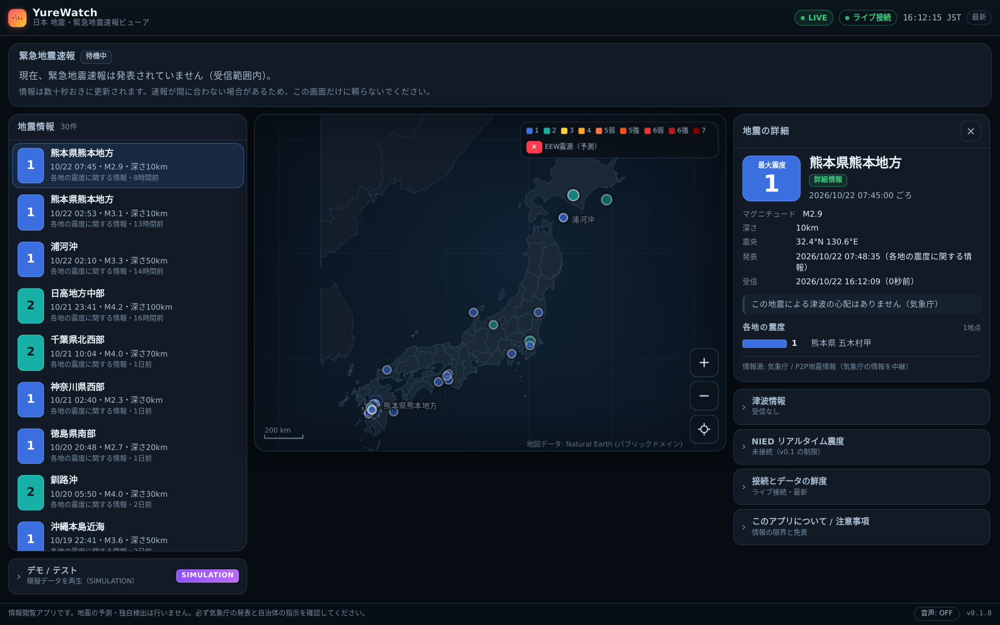

---

## Contents

- [What it does](#what-it-does)
- [The interface](#the-interface)
- [Screenshots](#screenshots)
- [Install / run](#install--run)
- [Languages](#languages)
- [Build the APK](#build-the-apk)
- [Demo mode](#demo-mode)
- [Audio and speech](#audio-and-speech)
- [Data sources & honesty rules](#data-sources--honesty-rules)
- [Architecture](#architecture)
- [Tests](#tests)
- [Limitations](#limitations)
- [Attribution & licensing](#attribution--licensing)
- [Relationship to the reference project](#relationship-to-the-reference-project)

---

## What it does

| Area | v0.2 behaviour |
| --- | --- |
| **Layout** | Map-first. Desktop: map + one 372 px instrument sidebar (list / details / info). Phones: map everywhere, panels in a two-state bottom sheet that opens as a 64 px peek. |
| **Map** | Canvas-rendered Japan (47 prefectures, own projection code, Natural Earth geometry). Drag to pan, pinch/scroll/double-tap to zoom, keyboard arrows + `+`/`-`/`Home`. Tap an epicentre to select it. The initial framing fits the main islands and Okinawa; detached islets stay reachable by panning. |
| **Epicentres** | Marker size scales with magnitude, colour and inner numeral with observed JMA intensity, dashed ring for preliminary reports, fade with age, white selection ring. A live EEW shows a red crosshair (prediction, not an observation). |
| **Alert area** | A 30 px strip ("緊急地震速報 受信なし") when nothing is in effect; expands into a banner only for forecast / warning / update / cancelled / unavailable, with the classification first. |
| **Event list** | One row per event on a shared grid — intensity, epicentre, magnitude, age — aligned so values can be compared down the column. |
| **Event detail** | Max intensity, hypocentre, coordinates, origin/issued/received times (kept distinct), tsunami statement, per-station observations, source provenance. Unknown values print `—`, never `0`. |
| **Connection health** | Connection state in the header *in words*, data freshness in the status strip, and a diagnostics panel (batches, rejected records, duplicates, last error) inside the info panel. A stalled transport is never labelled "up to date" just because the last packet was recent. |
| **Tsunami** | Latest 津波予報 with grades, areas and heights; a chip in the status strip while a bulletin is in force. **Tsunami forecast-region layer** (`津波予報区`, JMA GIS data) colouring only the areas the bulletin names. |
| **Spoken alerts** | Optional TTS through the platform voice (`speechSynthesis` → Android system TTS), Japanese or English to match the UI, deduped per revision, cancellations announced, tests and simulated alerts never spoken. |
| **Map detail** | Coastline from Natural Earth 1:10m at 0.0015° (≈2× the vertices of v0.1.1), lakes as holes, islands ≥ 0.01 km². Detail limits documented and measured in [docs/DATA_SOURCES.md](docs/DATA_SOURCES.md). |
| **Map legend** | Collapsed button on the map; explains marker shapes as well as intensity colours, and says explicitly that no intensity-distribution map is provided. |
| **Demo mode** | Nine deterministic scenarios, all visibly marked `SIMULATION`, kept in a separate "開発者向け" group. |
| **Languages** | Japanese (default) and English, switchable from the header and the info panel, applied instantly to every panel, label, column header, error and accessibility name, and persisted through Android `SharedPreferences`. |
| **Android** | Single APK, no local server, no localhost, back gesture, lifecycle-aware polling, HTTPS-only native bridge. |

---

## The interface

The v0.2 shell is three fixed bands and a working area:

```
header       brand · connection (in words) · JST clock · 日本語|English · info
status strip LIVE/DEMO · source · last update · freshness
alert slot   one line while nothing is in effect; a banner when it is
work area    map (+ legend, zoom, recenter)  |  list / details / info
```

Design rules the layout is held to (full rationale in [docs/UI.md](docs/UI.md)):

- **Map first.** The map takes more than half of the working area at every target
  viewport (measured 66–89 %), and Japan is framed without panning on first
  launch.
- **No empty alarm furniture.** A large "all clear" card is not shown; the idle
  state is a single strip, because a permanent big green box is decoration that
  teaches people to stop looking at it.
- **Nothing is invented.** Unknown intensity, depth or time prints `—`/`未発表`;
  origin, issue and receive times are labelled as different things; a preliminary
  report is marked preliminary.
- **States are legible without colour**, and cancelled/unavailable never read as
  "safe".
- **Phones are designed, not squeezed.** Below 900 px the map is the screen and
  the panels live in a bottom sheet that starts as a one-line peek.
- **The legend explains shapes, not just colours**, and states that no
  intensity-distribution map is offered.

## Screenshots

Every screenshot is captured from `dist/yurewatch.html` — the exact file the APK
embeds — by `node tools/screenshots.mjs`, so a shot can never show a UI the
release does not have. Demo shots are labelled `SIMULATION` because they are
simulations.

| Live (desktop) | EEW warning (demo) |
| --- | --- |
|  | 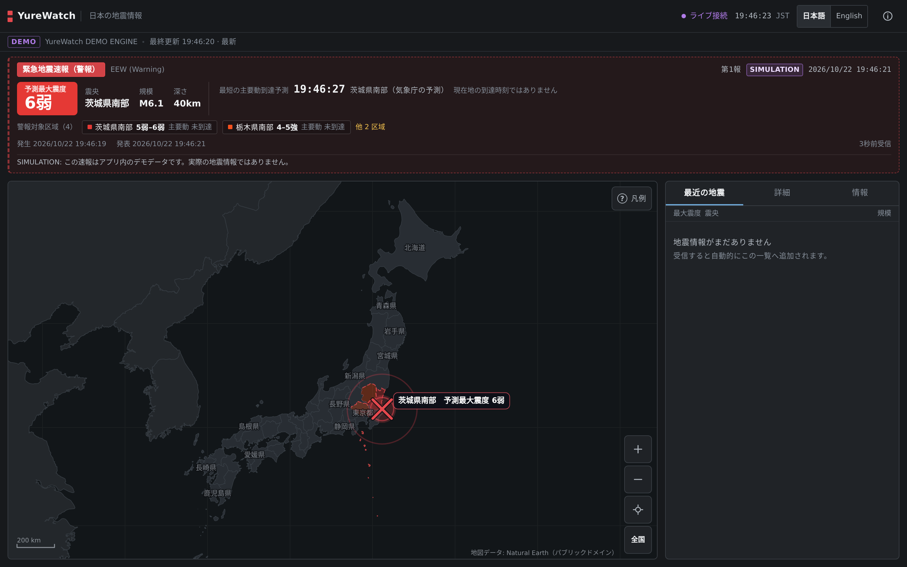 |

| Earthquake details | Info / diagnostics |
| --- | --- |
| 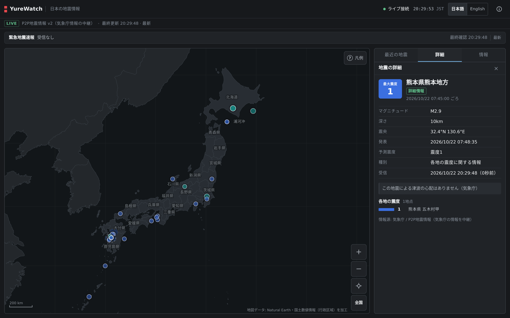 | 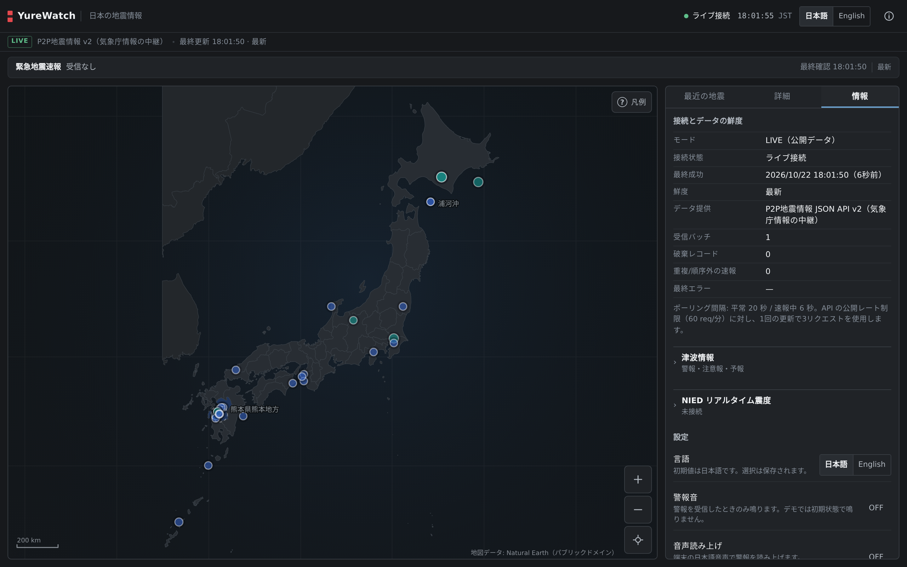 |

| Map legend | EEW cancelled (demo) |
| --- | --- |
| 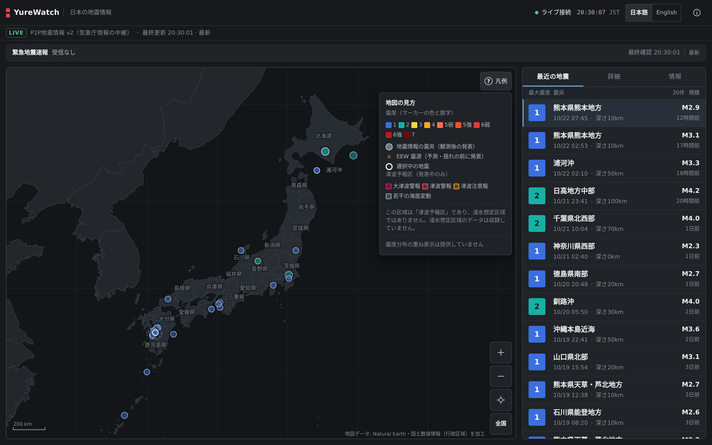 | 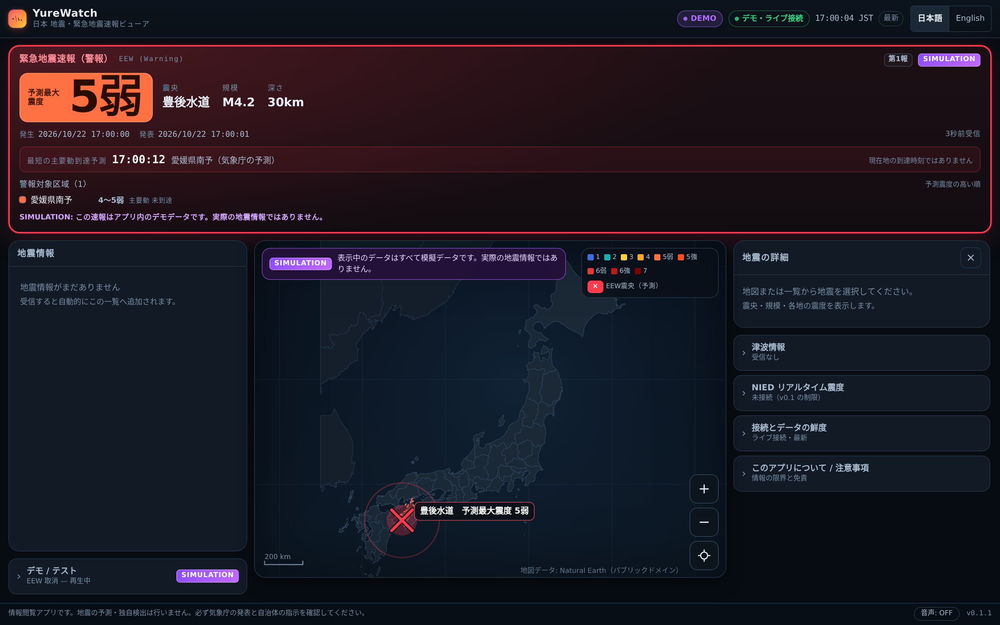 |

| Phone, live (ja) | Phone, EEW warning (demo, ja) |
| --- | --- |
| 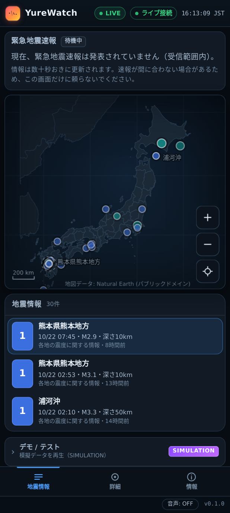 | 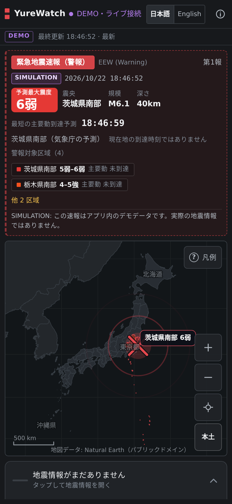 |

| Phone, panel expanded | Tablet, live |
| --- | --- |
| 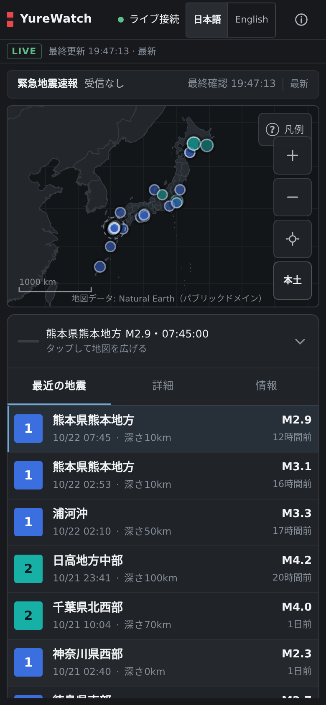 | 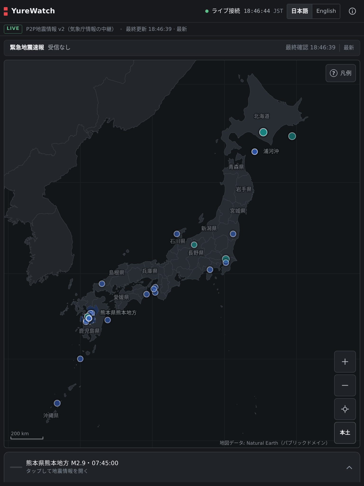 |

| English, live | English, EEW warning (demo) |
| --- | --- |
| 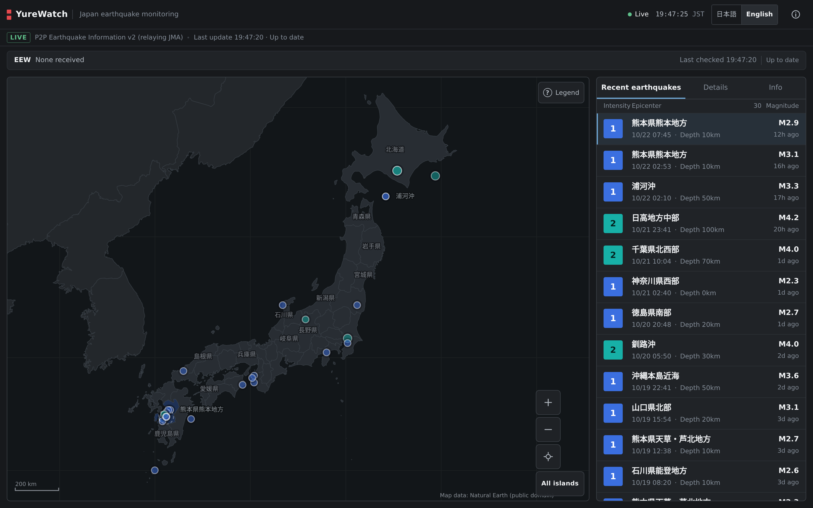 | 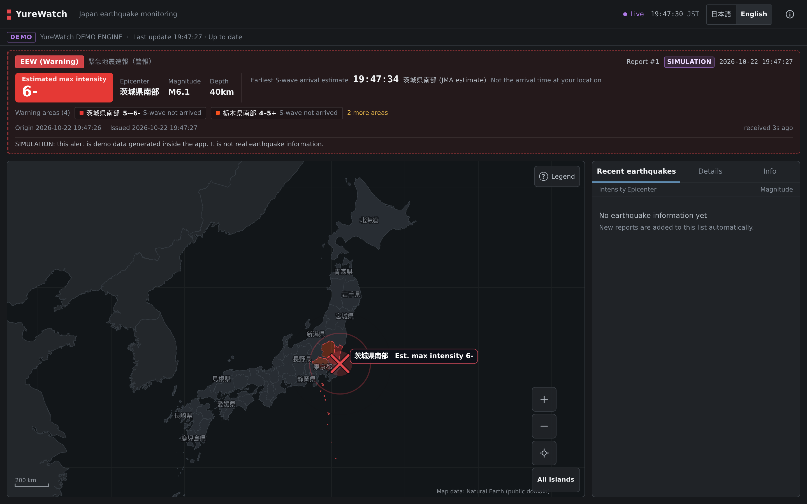 |

---

## Install / run

### Android APK

**Latest published APK (v0.4.0):**
[yurewatch-0.4.0.apk](https://github.com/franzathome2024-hue/yurewatch/releases/download/v0.4.0/yurewatch-0.4.0.apk)
— SHA-256 `6a334093c77c5272f4fc3e58b582f968a20f90903864f90d5e70cfc2612afac3`
(also in [SHA256SUMS](https://github.com/franzathome2024-hue/yurewatch/releases/download/v0.4.0/SHA256SUMS)),
built from tag `v0.4.0` (`3103af9`), 226,233 B, versionCode 6 / versionName 0.4.0.
That checksum is for the **release asset as published by CI**, and it was verified
by downloading the asset and re-hashing it. A local `bash tools/build-apk.sh`
produces a byte-different file (different throwaway signing key, ~181 KiB), so
compare against the release, not against a local build.
Android 7.0 (API 24) or newer. You will need to allow installation from
unknown sources, because this is not distributed through Google Play.

Updating: CI builds are signed with a *throwaway* key, so Android refuses to
install a new release over an older one with `INSTALL_FAILED_UPDATE_INCOMPATIBLE`.
Uninstall the old version first (`adb uninstall net.yurewatch.app`, or long-press
the icon → Uninstall). Your language preference is stored per app install, so it
is reset by a reinstall.

To build it yourself instead:

```bash
# Build (produces build/yurewatch-0.4.0.apk)
npm ci
bash tools/build-apk.sh

# Install on a connected device
adb install -r build/yurewatch-0.4.0.apk
```

The app opens directly into the map. It does **not** start a local server, ask
for a URL, or need a computer. On first launch it polls the public feed; if the
network is unavailable it says so instead of showing invented data.

**If you only ever see a loading bar and the YureWatch wordmark**, you opened
`index.html` from the repository (the *source* entry point) instead of a built
file. That page needs the bundler. Either install the APK above, or open
`dist/yurewatch.html` (`npm run build` produces it) — a single self-contained
file with no external references. The app watches its own startup and, after six
seconds, replaces the splash with an explanation and a reload button rather than
sitting on a logo forever.

Releases: when a `v*` tag is pushed, `.github/workflows/android.yml` builds the
APK and attaches it to the GitHub Release. CI builds are signed with a throwaway
key generated at build time — see [Signing](#signing).

### Web build & website

**Live: https://franzathome2024-hue.github.io/yurewatch/** — landing page, with
the browser viewer at [`/viewer/`](https://franzathome2024-hue.github.io/yurewatch/viewer/).

```bash
npm ci
npm run dev          # http://localhost:5173  (dev server, for development)
npm run build        # dist/yurewatch.html — one self-contained file
npm run preview      # serve dist/ over HTTP
npm run site:build   # assemble the Pages site (landing page + viewer) -> _site/
npm run site:serve   # preview it at http://localhost:4173/yurewatch/
npm run verify:site  # headless-browser checks against that preview
```

`dist/yurewatch.html` has **zero external references** (no CDN, no fonts, no
image URLs); the build fails if one appears. Open it from the filesystem or from
any static host. The public website is that same file served at `/viewer/` next
to a hand-written landing page — one application, one build, deployed by
`.github/workflows/pages.yml` on pushes to `main` (tags and APK releases are a
separate workflow and never interact). See [docs/WEBSITE.md](docs/WEBSITE.md)
for the deployment, verification and rollback procedures.

The web viewer is also an **installable PWA**: it registers a service worker
that caches only the application shell for offline startup and never intercepts
or caches feed data, so a cached warning can never be presented as current.
See [docs/PWA.md](docs/PWA.md) for the evaluation, the caching policy, and an
honest PWA-vs-APK comparison (including what browsers cannot guarantee:
background EEW delivery and notifications are not offered or promised).

---

## Map framing

Two explicit profiles, switchable from the control column on the map (`全国` / `本土`,
or `?frame=mainland|archipelago`):

- **本土 (mainland)** — Hokkaidō, Honshū, Shikoku, Kyūshū and their coastal islands
  (everything from 30 °N). Opens by default on landscape panes.
- **全国 (archipelago)** — adds the Nansei chain including Okinawa and the Ogasawara
  group. Opens by default on portrait panes.

Each profile's camera rectangle is measured from the rings it includes, so nothing a
profile claims is ever cropped at the canvas edge. Five islets below 26.5 °N under
0.02 deg² (three Izu volcanoes, two Kerama islets) are drawn and reachable by panning
but do not set the frame — otherwise 2,800 km of empty Pacific would halve the scale of
the mainland. `docs/MAP_QA.md` records the measured before/after results.

## Languages

YureWatch ships two complete locales. **Japanese is the default**, regardless of
the device language, and the choice is remembered.

| | Japanese (default) | English |
| --- | --- | --- |
| Switch | `日本語 \| English` in the header | same control |
| Default on a fresh install | yes | no |
| Alert headline | `緊急地震速報（警報）` | `EEW (Warning)` |
| Intensity scale | `5弱` / `5強` | `5-` / `5+` (JMA's "5 lower" / "5 upper" in long form) |
| Timestamps | `2026/10/22 16:56:14` (JST) | `2026-10-22 16:56:14` (JST) |
| Stored in | `SharedPreferences` (`yurewatch.locale`) on Android, `localStorage` on the web | same |

How it works:

- **One catalog per language** — `src/i18n/ja.ts` is the source of truth for the
  key set; `src/i18n/en.ts` is typed as `Record<MessageKey, string>`, so a missing
  or misspelled key is a **compile error**, not a silent fallback.
- **One translation function** — every component calls `t('key', params)`. There
  are no `if (locale === …)` branches in the UI, so the two languages cannot drift
  apart functionally. A language switch is an ordinary re-render: `setLocale()`
  bumps a version counter that every memoised panel includes in its cache key.
- **Tests enforce parity** — same keys, same placeholders (`{n}`, `{time}`…), no
  empty strings, and no untranslated English sentences left in the Japanese
  catalog (`tests/i18n.test.ts`).
- **The other language is always visible where it matters.** The EEW headline
  shows the active language with the other language underneath, so one screen
  reads correctly to a Japanese and an English speaker standing in front of it.
- **Source data is not translated.** Epicentre and area names (`茨城県南部`,
  `東京都２３区`) stay exactly as JMA issued them: translating a place name would
  invent information the source did not provide.
- **Official wording is preserved.** 予報 is never rendered as "Warning"; 取消 is
  "Cancelled"; 津波注意報 is "tsunami advisory". Where the app relays a JMA
  sentence, the translation keeps its meaning and its hedge ("in effect",
  "checking", "no tsunami concern from this earthquake").
- **Times are always `Asia/Tokyo`** in both languages, independent of the device
  timezone and locale.

Adding a third language means adding one catalog file plus a line in
`src/i18n/index.ts`; see `docs/I18N.md`.

---

## Build the APK

Requirements: JDK 11+ (17/21 verified), Android SDK with platform 34 and
**build-tools 35.0.0 or newer**, Node 18+.

`tools/build-apk.sh` uses the SDK build tools directly (aapt2 → javac → d8 →
zipalign → apksigner) instead of Gradle. The app is two Java classes and one
HTML asset, so there is nothing for a build system to do that a wrapped shell
script cannot, and the whole build is auditable in one file.

```bash
ANDROID_HOME=/path/to/sdk bash tools/build-apk.sh
```

| Step | Tool | Output |
| --- | --- | --- |
| Web bundle | Vite + `scripts/inline-single-file.mjs` | `android/app/assets/index.html` |
| Resources | `aapt2 compile` / `aapt2 link` | `build/base-unsigned.apk` |
| Java | `javac` against `android.jar` | `build/classes` |
| Bytecode | `d8 --min-api 24` | `build/dex/classes.dex` |
| Package | `zip`, `zipalign -p 4` | `build/app-aligned.apk` |
| Sign | `apksigner` | `build/yurewatch-<version>.apk` |

`apksigner verify --print-certs` and `aapt2 dump badging` run at the end of the
script, so a build that did not actually produce a valid, signed APK fails
loudly.

> **Known toolchain trap:** build-tools **34.0.0** ships an R8/d8 build that
> crashes with `NullPointerException: Cannot invoke "String.length()" because
> "<parameter1>" is null` on any class containing an anonymous inner class. This
> was reproduced with a two-line test class and is not caused by this project's
> code. The script therefore prefers build-tools 35+; pin `BUILD_TOOLS_OVERRIDE`
> if you need a specific version.

<a id="signing"></a>
### Signing

If `KEYSTORE` is unset, the build generates a throwaway debug keystore under
`android/keystore/` (git-ignored). For a distributable build, pass a real key:

```bash
KEYSTORE=/secure/release.jks KEYSTORE_PASS=… KEY_ALIAS=… KEY_PASS=… \
  bash tools/build-apk.sh
```

No key material, password or token is committed. `.gitignore` covers
`android/keystore/`, `*.jks`, `*.keystore` and `.env*`.

---

## Demo mode

Append `?demo=<scenario>` to the app URL (or `--es demo <scenario>` via adb, and
in-app via **デモ / テスト**):

| Scenario | Key | What it exercises |
| --- | --- | --- |
| 平常時 | `normal` | No EEW; historical events populate feed + map. |
| EEW 予報 | `forecast` | Area-less telegram → shown as **予報**, never as 警報. |
| EEW 警報 | `warning` | Warning with predicted max intensity and 4 target areas. |
| EEW 続報 | `updated` | Serials 1→3, magnitude/intensity revisions, PLUM-only area. |
| EEW 取消 | `cancelled` | Cancellation wording that does not imply safety. |
| 過去の地震情報 | `historical` | 震度速報 → 震源情報 → 各地の震度 merge; 暫定 badges. |
| 通信断 → 復旧 | `disconnect` | Offline state, then recovery. |
| 情報の停滞 | `stale` | Data stops updating → 情報が古い. |
| データ欠損 | `unavailable` | Malformed records + empty responses. |

```bash
adb shell am start -n net.yurewatch.app/.MainActivity --es demo warning
```

Demo payloads are shaped exactly like the real API's JSON and travel through the
same parsers, so the demo exercises production code. They are tagged with a
non-official source, which sets `simulated: true` on every model object; the UI
paints a `SIMULATION` banner, badges each row, and the alert panel refuses to use
the "official warning" treatment. **Audio is muted for simulated alerts unless
you explicitly add `&demoAudio=1`** (developer opt-in, also available as a source
flag). Demo data is never mixed into live state: starting either mode resets the
other.

---

## Audio and speech

Both channels are **off by default** and both require an explicit tap.

| | Tone | Voice |
| --- | --- | --- |
| Engine | WebAudio oscillators, no bundled audio file | `speechSynthesis` → the platform TTS (Android system TTS in the APK) |
| Network needed | no | no, but a Japanese voice must be installed on the device |
| Speaks for | warning / update / forecast | warning / update / forecast / **cancellation** / tsunami bulletin |
| Never for | test transmissions, simulated alerts (unless `?demoAudio=1`) | same, plus never invented numbers: fields JMA did not issue are left out of the sentence |
| If unavailable | silent (no error) | the toggle shows a localised reason instead of pretending to work |

Details, failure states and exactly what is and is not verified: [docs/AUDIO.md](docs/AUDIO.md).

---

## Data sources & honesty rules

Full detail, including terms review and rejected sources:
[`docs/DATA_SOURCES.md`](docs/DATA_SOURCES.md).

**In use — P2P地震情報 JSON API v2** (free, no key, documented, rate-limited):

- `GET https://api.p2pquake.net/v2/history?codes=556` — 緊急地震速報（警報）
- `GET …/history?codes=551` — 地震情報
- `GET …/history?codes=552` — 津波予報

Published limits: 60 req/min for `/history`, 10 req/min for `/jma`, 2 WebSocket
connections per IP. YureWatch issues 3 requests per tick at 20 s idle / 6 s
during an alert — between 9 and 30 req/min, inside the limit. The provider states
the API is free for commercial and non-commercial use.

Rules the code enforces (each has a unit test):

1. **`/history` is a history endpoint.** It returns days-old telegrams. EEW
   telegrams are gated to a 10-minute window before they can become an alert;
   tsunami bulletins are gated to 12 hours and only the newest is shown. Without
   this gate a week-old EEW would appear as an active warning — this was caught
   in testing and fixed.
2. **予報 ≠ 警報.** A telegram with no 警報対象区域 is a forecast. It gets its own
   colour, wording and (absent) intensity treatment.
3. **No invented numbers.** JMA sentinels (`-1` depth/magnitude, `-200`
   coordinates, `-1` scale) become "不明", never `0`. Missing timestamps stay
   missing ("時刻不明"), never "now".
4. **No invented countdown.** Arrival times are shown only when the source
   provides them per area, always labelled as a JMA prediction and explicitly
   *not* the user's own arrival time.
5. **Stale data is labelled stale.** A watchdog reclassifies the feed after 150 s
   without a successful poll; the header chip and the alert panel say so, and the
   panel refuses to claim "no alert is in force" while offline.
6. **Cancellations do not imply safety** — the wording says so.
7. **Preliminary estimates stay preliminary** — 震度速報-derived events carry a
   暫定 badge and a dashed marker ring until a 詳細 report arrives.

Not connected in v0.1 (and not faked): **NIED real-time intensity** (no
documented, licensed machine-readable API was identified — the panel says exactly
that) and **tsunami observations** (only 津波予報 is relayed by the source).
**DM-D.S.S.** is not used: it is a paid service with per-account credentials, and
the reference project's credentials are not transferable. A DM-D.S.S. adapter is
the documented upgrade path.

---

## Architecture

```
src/
  core/        models.ts, intensity.ts, time.ts, format.ts   ← domain types + JMA vocabulary
  sources/
    p2pquake/  wire.ts, parse.ts                             ← wire format + pure parsers
  state/       store.ts, alert.ts, events.ts                 ← reducer, EEW state machine, merges
  net/         transport.ts, liveFeed.ts                     ← HTTP bridge + polling/backoff/watchdog
  demo/        scenarios.ts, engine.ts                       ← deterministic simulation
  map/         geo.ts, mapData.ts, scene.ts, renderer.ts, view.ts, theme.ts
  i18n/        index.ts (runtime + t()), ja.ts, en.ts, storage.ts  ← localisation
  ui/          app.ts, header.ts, alertPanel.ts, eventList.ts, details.ts,
               sections.ts, demoPanel.ts, audio.ts, dom.ts
  data/        japan-map.json (generated), prefectures.ts
```

Key decisions (full rationale in [`docs/ARCHITECTURE.md`](docs/ARCHITECTURE.md)):

- **No UI framework.** ~200 KiB of DOM code that re-renders small panels from an
  immutable state object. It keeps the Android asset a single file and keeps
  rendering deterministic enough to unit test.
- **Pure core.** Parsers, the EEW state machine and scene construction are pure
  functions; `tests/` exercise them without a browser or a network.
- **One feed interface, two implementations.** `LiveFeed` and `DemoFeed` both
  emit `{connection,batch}` events into the same reducer, so demo and live cannot
  diverge in behaviour — only in provenance.
- **Canvas map, no tile server.** Geometry is compiled to `Path2D` once and the
  transform is animated per frame. No third-party map SDK, no API key, no tiles
  to fetch — which is also why the app works offline for everything except the
  feed.
- **Localisation as data, not branching.** One catalog per language, one `t()`
  call site pattern, and a locale version counter in every render cache key, so a
  language switch is a plain re-render. Details in [`docs/I18N.md`](docs/I18N.md).
- **Native HTTPS bridge on Android** instead of page `fetch`: a WebView loading
  from `file://` has an opaque origin, so cross-origin requests are blocked by
  CORS. The bridge also sets an honest `User-Agent` and keeps the request off the
  page's origin. No local HTTP server is started at all.

---

## Tests

```bash
npm test                  # 229 unit tests (vitest, jsdom)
npm run typecheck         # tsc --noEmit, strict
npm run build             # tsc + vite + single-file inliner (+ external-ref check)
node tools/verify-web.mjs # 68 browser integration checks (needs playwright)
node tools/screenshots.mjs # regenerates docs/screenshots/ from dist/
bash tools/build-apk.sh   # produces a signed, verified APK
```

Coverage by area:

| File | What it pins down |
| --- | --- |
| `tests/parse.test.ts` | Wire → model: sentinels, provisional hypocentres, malformed records, simulation tagging, revision merging. |
| `tests/alert.test.ts` | State machine: new/updated/duplicate/out-of-order/cancelled/test, TTL expiry, arrival selection. |
| `tests/events.test.ts` | Feed merging, ordering, de-duplication, per-prefecture intensity reduction. |
| `tests/store.test.ts` | Reducer: connection health, alert lifecycle, demo isolation, selection stability, freshness bands. |
| `tests/geo.test.ts` | Mercator round-trips, fit-inside-viewport, zoom anchoring, pan clamping. |
| `tests/scene.test.ts` | Marker projection/culling/selection, intensity shading, EEW crosshair, hit testing, label collision. |
| `tests/demo.test.ts` | Scenario catalogue integrity, determinism, per-scenario outcomes, simulation flags. |
| `tests/liveFeed.test.ts` | Polling cadence, rate-limit budget, HTTP/network/JSON failures, backoff, stale watchdog, recency gating. |
| `tests/data.test.ts` | The 47-prefecture table and the map geometry cannot drift apart. |
| `tests/ui.test.ts` | Panel rendering: warning vs forecast wording, offline wording, SIMULATION labels, provenance. |
| `tools/map-qa.mjs` (`npm run qa:map`) | Browser harness: 8 viewport classes, live camera vs re-projected geometry vs rendered pixels. 88 checks; screenshots in `docs/qa/`. |
| `tests/uiShell.test.ts` | v0.2 shell: mount order (header, strip, alert, map, sidebar), view switching, sheet peek/full cycle keeping the selection, sheet summary line, honest freshness (stalled transport ≠ "up to date"), strip vs banner, legend content in both languages, info-panel ordering (status → … → developer tools → about). |
| `tests/i18n.test.ts` | Catalog parity (keys + placeholders), Japanese default even on an `en-US` device, persistence, instant switching, locale-aware JST formatting, intensity vocabulary, and a full UI re-render on switch. |
| `tools/verify-web.mjs` | Real Chromium: boot, painted canvas, **Android bridge contract**, demo labelling, lifecycle hooks, back gesture, Japanese default, English switching, persistence across reload, accessibility-label translation, no horizontal overflow in English, **plus v0.2 layout measurements at 360×800 / 390×844 / 430×932 / 768×1024 / 1280×800 / 1440×900** (Japan fully framed, map > 55 % of the work area, no overflow, touch targets ≥ 30 px) **and the cancelled / offline / stale / info-panel states**. |

`tools/verify-web.mjs` fakes `YureWatchNative` with the same
`request(id, url, timeoutMs)` → `__yurewatchNativeResolve(id, json)` flow as
`NativeNet.java`, so the bridge that ships in the APK is exercised without a
device. **The Java side itself was compiled, dexed and signature-verified, but
not run on a physical device or emulator in this environment (no KVM); that
remains a manual check.**

---

## Limitations

- **Not a safety device.** No guarantee of delivery, ordering or timeliness;
  treat every estimate as provisional.
- **Polling, not push.** 6–20 s cadence via `/history`, so alerts can arrive
  later than a WebSocket client would see them. The provider's WebSocket API is
  rate-limited to 2 connections per IP and drops after 10 minutes on the sandbox;
  moving to it requires reconnect handling and (on Android) a foreground service
  to survive doze. Not in v0.1.
- **NIED real-time intensity is not connected** (see above). The section states
  this rather than substituting a different dataset silently.
- **Tsunami observations** (measured wave heights) are not available from the
  current source; only 津波予報 is shown.
- **Android build is not device-tested here.** The APK is built, aligned, signed
  and verified, and the JS bridge contract is covered by integration tests, but
  no emulator/device run was possible in this environment.
- **CI builds are debug-signed.** Publish with your own keystore for real
  distribution.
- **Two languages, no others.** Japanese and English are complete; the UI has no
  third locale and no runtime machine translation. Epicentre and area names stay
  in Japanese in both languages because that is how the source issues them.
- **No background alerts.** The app polls only while in the foreground; there is
  no foreground service and no push notification. An EEW that arrives while the
  app is backgrounded will be seen on return if it is still within the freshness
  window — which, for a warning, it usually is not.
- Map geometry is simplified and **must not be used for navigation or
  measurement**; distances come from the scale bar only.

---

## Attribution & licensing

**Project code: MIT** (see [`LICENSE`](LICENSE)). Third-party notices:
[`THIRD_PARTY_NOTICES.md`](THIRD_PARTY_NOTICES.md).

| Component | Licence | Notes |
| --- | --- | --- |
| Map geometry (`src/data/japan-map.json`) | **Public domain** — Natural Earth 1:10m (admin-1, admin-0) | No attribution required; credited anyway. Regenerate with `npm run map:data`. |
| Earthquake/EEW/tsunami data | Provided via **P2P地震情報** (p2pquake.net); upstream information from 気象庁 (JMA) | Free for commercial and non-commercial use; API terms apply. JMA content is used under the Japanese government standard terms (public-data licence, attribution). This app is unaffiliated with JMA, NIED or p2pquake. |
| Alert tone | Synthesised at runtime with WebAudio | Original; no broadcast audio is redistributed. |
| App icon, UI, code | Original work, MIT | — |

No asset from the reference project is redistributed. See
[`docs/REFERENCE_INSPECTION.md`](docs/REFERENCE_INSPECTION.md).

---

## Relationship to the reference project

The visual language (dark map, intensity-coloured epicentres, intensity numeral
badges, tabbed information hierarchy, full-width alert area) is *inspired by*
[kotoho7/scratch-realtime-earthquake-viewer-page](https://github.com/kotoho7/scratch-realtime-earthquake-viewer-page).
That project is a Scratch/TurboWarp program packaged for the desktop with Tauri:
its logic lives in ~12,000 Scratch blocks and its `docs/assets` are CC BY-SA 2.0
Scratch assets. No code, artwork, map data or audio was copied. The design was
recreated from observation, with original geometry, palette, typography and
layout. Details and the licence review: `docs/REFERENCE_INSPECTION.md`.
